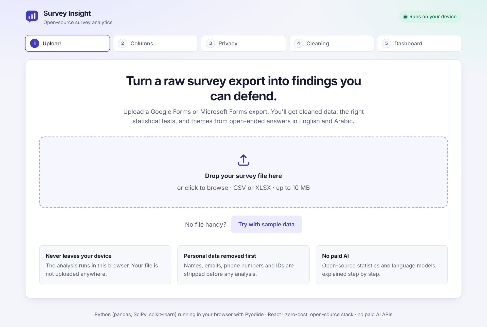
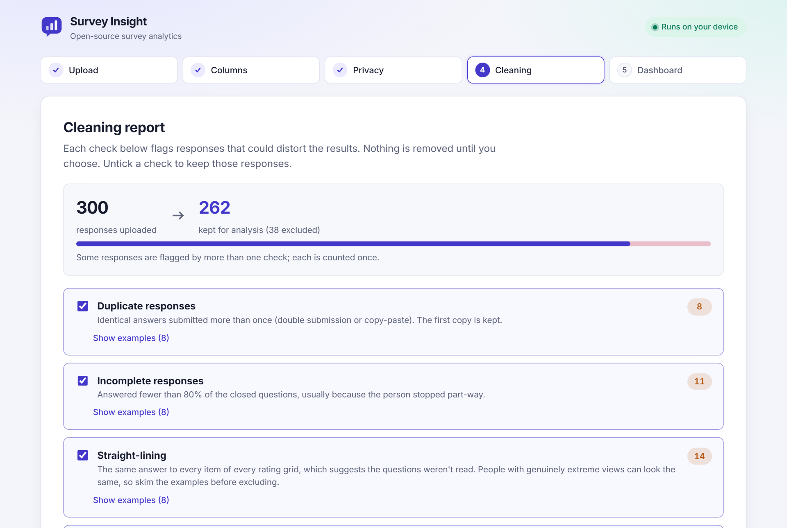
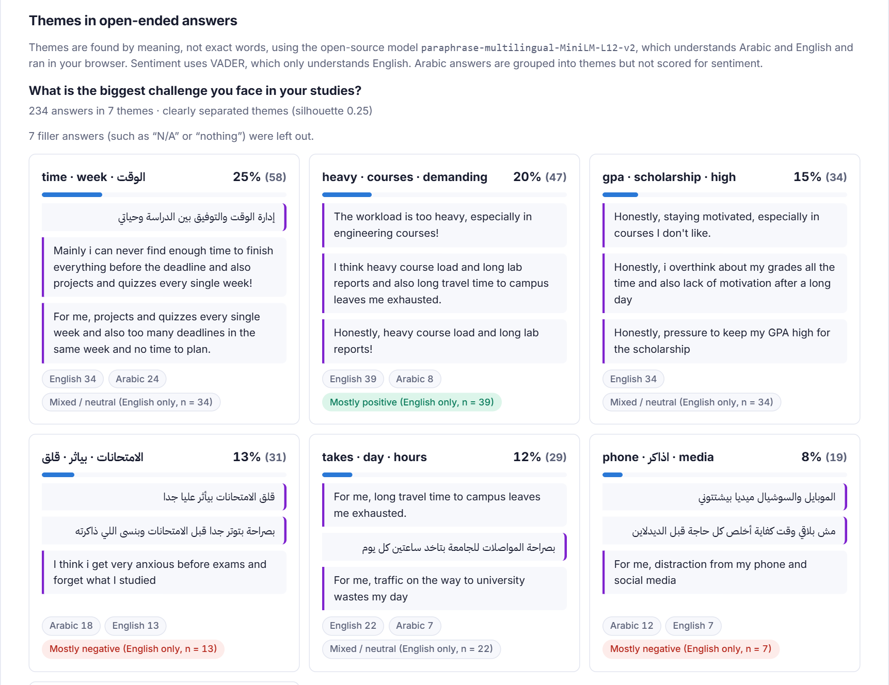
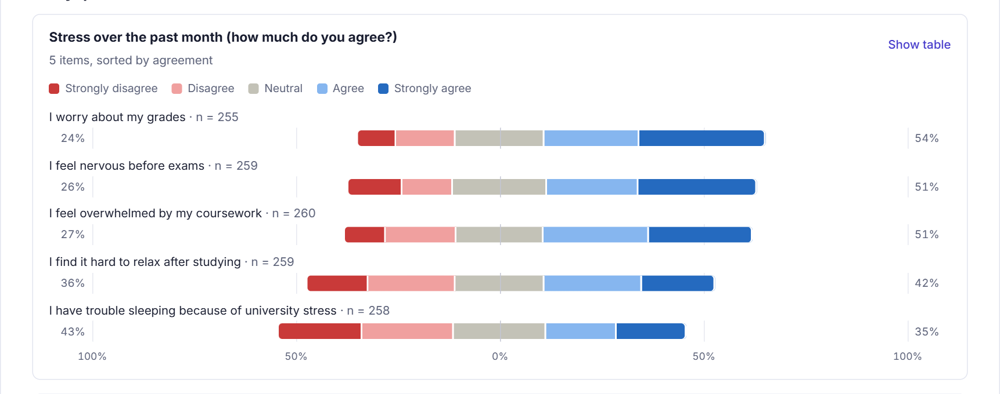
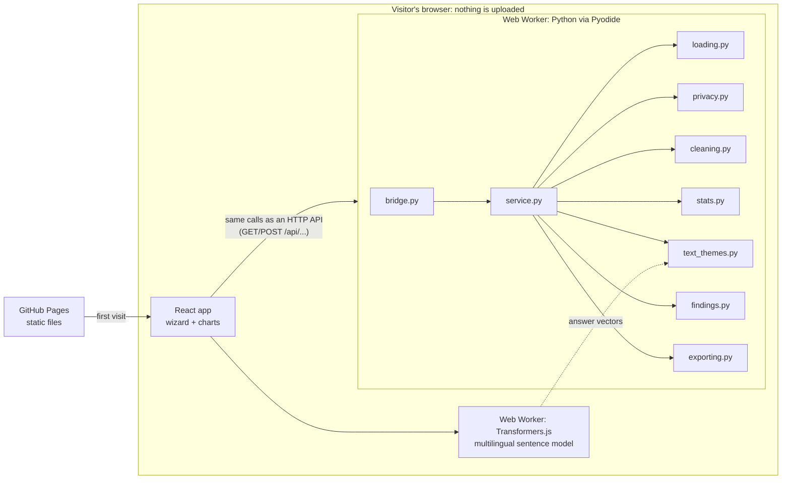
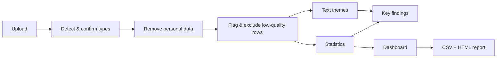

# Survey Insight

[](https://github.com/veevedzee/survey-insight/actions/workflows/ci.yml)


**Survey Insight turns a raw Google Forms or Microsoft Forms export into findings you can defend.**
Upload a CSV or Excel file and it detects what each column is, strips names, emails and phone
numbers before anything else happens, flags low-quality responses for you to review, picks the
right statistical test for every comparison (with effect sizes and multiple-comparison
correction), and groups open-ended answers in **English and Arabic** into themes with real
example quotes, all with free, open-source tools and no paid AI APIs. I built it after
running survey data pipelines for university research and wanting a tool that does the
statistics properly instead of producing pie charts.

**Live demo:** **https://veevedzee.github.io/survey-insight/**: no server, no sign-up. The
whole analysis runs in your browser (Python via Pyodide), so your survey never leaves your
device. Click **Try with sample data**. The first visit downloads Python (~40 MB) and the
language model (~135 MB); later visits load from cache.

| Upload & column detection | Cleaning report |
|---|---|
|  |  |
| **Key findings & themes** | **Charts** |
|  |  |


## Features

1. **Upload & column detection.** CSV (UTF-8 or Windows Arabic encoding, comma or semicolon)
   and XLSX. Every column is classified as Likert, single choice, multiple choice, numeric,
   free text, timestamp, personal identifier or ignore, with a plain-English reason. You
   can correct any type. Grid questions (`Question [item]`) are grouped into scales.
2. **Privacy first.** The hosted version analyses the file inside your browser, so it is
   never uploaded. Identifier columns are dropped; emails, phone numbers (including
   Arabic-Indic digits), student/national IDs and known names are masked inside written
   answers, and you see exactly what was removed. The original data is discarded as soon as
   columns are confirmed.
3. **Cleaning report.** Duplicates, incomplete responses, straight-lining, speeders (when
   start/end times exist) and numeric outliers (IQR fences), each with per-row reasons.
   You choose what to exclude and see live before/after counts. Spelling variants
   ("engineering ", "ENGINEERING") are merged automatically.
4. **Statistics.** Descriptives per question; Cronbach's α with item diagnostics and
   reverse-wording warnings; group comparisons with the test chosen from the data type and
   checked assumptions; Spearman correlations; effect sizes and Holm-adjusted p-values
   everywhere, written up in plain English without overclaiming.
5. **Text themes without paid AI.** A multilingual sentence model embeds answers **in the
   visitor's browser** (Transformers.js), the server clusters them with k-means (k chosen by
   silhouette score), c-TF-IDF labels each theme, and 3 diverse real quotes show what it
   contains. VADER sentiment for English answers only, and the UI says so.
6. **Dashboard.** Diverging stacked bars for Likert, sorted bars for choices, histograms for
   numbers, range plots and stacked bars for group comparisons, theme cards, and
   rule-based key findings. Every chart has a table view; colours are colour-blind-checked;
   light and dark mode. No pie charts, no word clouds.
7. **Export.** The cleaned, anonymised data as CSV (with scale scores, Excel-safe for
   Arabic) and a self-contained HTML report that opens offline and prints to PDF.

## Tech stack

| Layer | Tools |
|---|---|
| Analysis (Python) | Python 3.14 via **Pyodide** in the browser: pandas, NumPy, SciPy, scikit-learn, VADER |
| Text model | `paraphrase-multilingual-MiniLM-L12-v2` (ONNX, 8-bit) via **Transformers.js** |
| Frontend | React 19, TypeScript, Vite, Recharts, Web Workers |
| Optional server | FastAPI (same Python package) |
| Tests | pytest (+ coverage), Vitest, React Testing Library, ruff |
| Hosting | GitHub Pages + GitHub Actions — free, no server |

## Architecture



The Python package is written once and has two front doors: **`bridge.py`** (Pyodide, used by
the hosted demo) and **`api.py`** (FastAPI, for running it as a server). Both call the same
framework-free **`service.py`**, so the frontend uses the same API paths in either mode.
Themes take three steps: Python lists the answers to embed, the model worker turns them into
vectors, and Python clusters and labels them.

Data flows one way through the pipeline:



The FastAPI layer is deliberately thin: each module is plain Python that takes a DataFrame
and returns dataclasses, so it is tested without a web server.

## Run locally

Requirements: Node 20+ (and Python 3.12+ only for the tests or server mode).

```bash
# From frontend/
npm install
npm run dev
```

Open http://localhost:5173 and click **Try with sample data**. That's all: the Python package
in `backend/survey_insight` is copied into the site and runs in the browser.

**Server mode (optional):** run the same package with FastAPI and point the frontend at it.

```bash
# From backend/
python -m venv .venv
.venv\Scripts\activate            # macOS/Linux: source .venv/bin/activate
pip install -r requirements-dev.txt
uvicorn survey_insight.api:app --reload --port 8000
```

Then start the frontend with `VITE_API_URL=http://127.0.0.1:8000`. API docs:
http://127.0.0.1:8000/docs

The sample survey is synthetic (300 students, study habits and wellbeing, with planted
effects and deliberately messy rows). Regenerate it with `python sample_data/generate_sample.py`.

## Run tests

```bash
cd backend && pytest --cov=survey_insight      # ~115 tests, ~94% coverage
cd frontend && npm test                         # component and unit tests
```

Statistical functions are tested against hand-computed answers (e.g. Cronbach's α = 2/3,
Cramér's V = 1/3, Holm-adjusted p = [.03, .06, .06]); clustering is tested on fixed vectors
from a fake embedder whose right answer is known, and the browser-to-server vector exchange
is tested end to end (including malformed or missing vectors). CI also starts the server and
checks it stays under Render's memory limit.

## Design decisions

**Why these statistical tests.** Likert answers are ordinal: "Agree" is above "Neutral", but
the gap isn't a known distance, so averaging the codes 1-5 is questionable. Likert items are
compared with **Mann-Whitney U** (2 groups) or **Kruskal-Wallis** (3+), which use ranks. Means-based
tests (**Welch's t-test**, **one-way ANOVA**) are used only for numeric data and scale scores
after checking each group looks roughly normal (Shapiro-Wilk for small groups, skewness for
large ones) and, for ANOVA, similar variances (Levene); otherwise the app falls back to the rank
tests and says why. Categorical pairs use **chi-square** (Fisher's exact test for small 2×2
tables). Every result reports an **effect size** (r, ε², d, η², Cramér's V, ρ), because with
hundreds of responses trivial differences become "significant". Running dozens of tests
guarantees false positives, so all p-values are **Holm-adjusted**. Groups smaller than 5 are
left out, n is always shown, "not significant" is never phrased as "no difference", and
correlations always say "association, not cause".

**How themes are found without paid AI.** Each answer is turned into a 384-number vector by a
small open-source multilingual model, so answers with similar meaning are close together even
across languages ("the commute takes two hours" ≈ "المواصلات بتاخد ساعتين"). k-means groups
the vectors; the number of themes is the k (2-8) with the best **silhouette score**. Each theme
is labelled with **class-based TF-IDF** keywords (after normalising Arabic spelling variants)
and shown with three diverse quotes nearest its centre, so readers can judge the label
themselves. Sentiment uses **VADER**, an English word list, so Arabic answers are deliberately
not scored and the UI says so. Key findings come from explicit rules over the computed
statistics, never from a language model, so each sentence is traceable to a test.

**Privacy.** On the hosted version the file is never uploaded: Python runs in the visitor's
browser. Personal data is still removed before any analysis, in two layers: identifier columns
are dropped (detected from headers and values), and written answers are scanned for emails,
phone numbers, IDs and names. Detection is tuned per context: aggressive on whole columns
(dropping a column wrongly costs nothing) and conservative inside text (single first names
such as "Nour" are also ordinary Arabic words). Nothing is written to disk: uploads live in an
in-memory store with a 30-minute expiry, and the original upload is discarded as soon as the
types are confirmed. Known limitation: names written inside answers are only caught when the
same name appears in a name column, since general name recognition (especially in Arabic)
needs a heavier model than free hosting allows.

**Zero-cost hosting: no server at all.** The plan changed twice, and the reasons are worth
knowing. With the embedding model on the server (PyTorch + sentence-transformers) the backend
needed ~910 MB of RAM; Hugging Face stopped offering free Docker Spaces in 2026. Moving the
model into the browser (Transformers.js, ONNX 8-bit, ~135 MB cached) cut the backend to
~200 MB, which fits Render's free tier, but Render then required a credit card. So the
backend moved into the browser too: **Pyodide** runs the unchanged Python package (pandas,
SciPy, scikit-learn) in a Web Worker, and **GitHub Pages** serves the static site for free.
Trade-offs: a ~40 MB + ~135 MB first download, slower analysis on weak phones, and the
visitor's device does the work. In return: zero cost, no cold starts, nothing to keep
running, and the strongest privacy guarantee (the data never leaves the device). The FastAPI
server mode remains for anyone who wants it.

**Smaller choices.** Rule-based column detection (every guess has a reason the user can fix);
IQR outlier fences instead of z-scores (the mean and SD are pulled by the very outliers being
detected); straight-lining only flagged when *every* grid is flat; charts chosen so
comparisons use lengths on a common baseline; HTML report snapshotted from the dashboard so
there is one implementation of each chart.


## What I'd add next

- **Post-hoc tests** (Dunn's test with Holm correction) to say *which* groups differ after a
  significant Kruskal-Wallis, not just the highest and lowest.
- **Reverse-scored items**: let the user mark reverse-worded items before computing α.
- **Arabic sentiment** with a small open-source Arabic model (e.g. a CAMeLBERT sentiment
  variant), if it fits free-tier memory.
- **Better name detection** in free text with a lightweight multilingual NER model.
- **Respondent-level duplicate detection** using a salted hash of the email before it is
  dropped, to catch re-submissions with different answers.
- **Weighting** for unrepresentative samples, and confidence intervals on every estimate.
- **Shareable reports** stored temporarily with an expiring link.
- **Faster in-browser embedding**: WebGPU where available, or multi-threaded WebAssembly via
  cross-origin isolation headers.
- **Offline support** with a service worker, so the app works without internet after the
  first visit.

## Deployment

Free deployment on GitHub Pages (one setting to switch on): see [DEPLOYMENT.md](DEPLOYMENT.md).

## License

[MIT](LICENSE)
